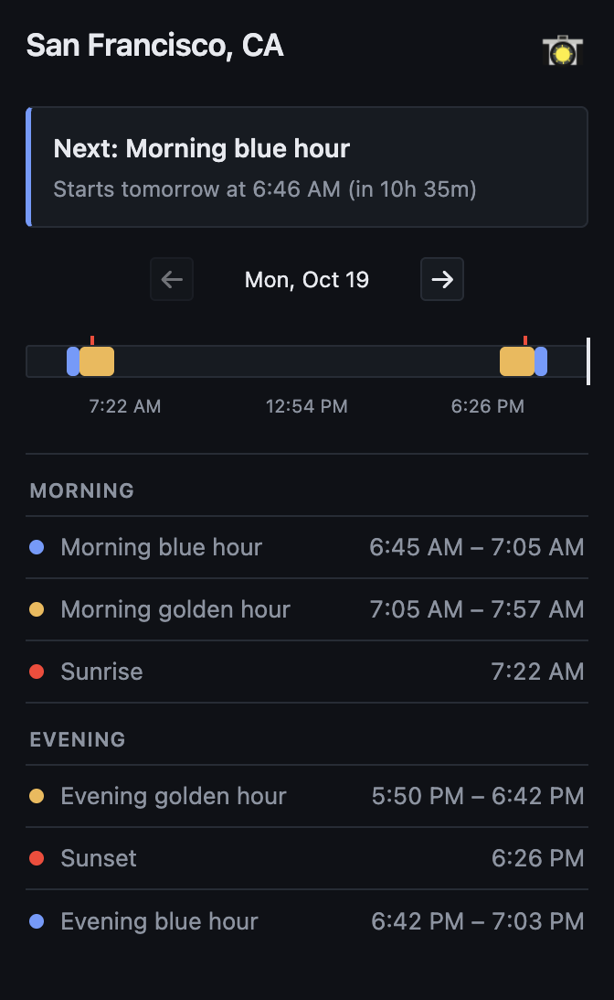

# Golden Hour Finder

A browser extension that shows golden hour, blue hour, sunrise, and sunset
times for the location currently open in Google Maps.

## Features

- Reads a place pin, search result, or map view from the active Google Maps tab
- Shows today's light phases in a compact timeline
- Buttons to check days in the future
- Displays local times using the location's time zone
- Resolves device locations to an approximate nearby place name when online

## Device coordinates
Device coordinates are used locally for solar calculations. When device
location is enabled, the extension optionally sends them to OpenStreetMap's
Nominatim service to display an approximate place name; if that lookup is unavailable, the popup
shows a friendly fallback instead. See [PRIVACY.md](./PRIVACY.md) for the
data handling summary.

## Planned expansions
- Light Mode Theme
